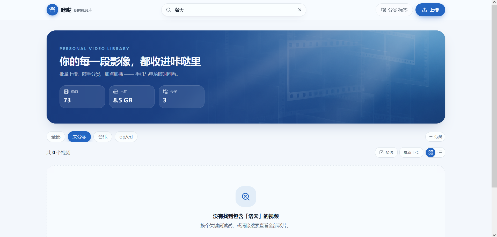

# 咔哒 · kada

> 你的每一段影像，都收进咔哒里。

一个跑在自己电脑上的**个人视频库**：把散落在硬盘各处的视频批量拖进来，自动抽封面、按分类和标签整理，电脑、手机、平板在同一个局域网里随时点开就播。不依赖任何云服务，数据全在自己手里。



## 它解决什么问题

- 手机拍的视频、下载的番剧、录屏的素材，散在各种文件夹里找不到
- 不想把隐私视频上传到任何第三方云（优酷、阿里云盘、Google Photos……）
- 想在电视、平板、手机上都能看电脑里的视频，而不是拿 U 盘拷来拷去

咔哒就是你自己的私有 Netflix：一个 Node 进程跑在你的电脑或 NAS 上，浏览器打开就能用。

## 功能

- **批量上传**：拖进文件夹自动扫描，视频、图片、音频、笔记统一管理
- **自动抽封面**：用 ffmpeg 从视频里截一帧当封面，也支持手动指定
- **分类 + 标签**：分类（音乐 / op/ed / 未分类…）粗粒度分组，标签做细粒度检索
- **即点即播**：浏览器原生 `<video>`，支持拖动进度条、倍速
- **局域网访问**：前端绑 `0.0.0.0`，同一 WiFi 下的手机、平板、电视直接访问
- **搜索 + 多选**：按文件名搜索，多选后批量打标签、改分类、删除
- **零云依赖**：元数据存本地 SQLite，视频文件存本地 S3 兼容对象存储，断网也能用

## 技术栈

- 前端：React 19 + Vite 7 + TanStack Router + Tailwind v4 + Radix UI
- 后端：Node 22 内置 `node:sqlite` + 自写的 S3 兼容对象存储（`server/object-store.mjs`）
- 视频处理：ffmpeg（抽封面、转码）
- **不需要** Docker、Postgres、MinIO、Supabase、任何账号

## 快速开始

```bash
# 依赖：Node ≥ 22.5、pnpm、ffmpeg
pnpm install
pnpm build          # 构建前端
pnpm local          # 同时起 对象存储(9000) + 数据 API(8787) + 前端(3015)
```

浏览器打开终端打印的局域网地址（例如 `http://192.168.x.x:3015`）即可。

详细部署、换机迁移、开机自启、扩盘、故障排查见 **[DEPLOY.md](./DEPLOY.md)**。
每次功能改动的背景与取舍见 **[README-本地运行.md](./README-本地运行.md)**。

## 数据在哪

全部在项目的 `.data/` 目录里：

```
.data/library.db                  # 元数据（分类、标签、视频列表）
.data/objects/video-library/      # 视频原片 + 封面 + 网页版
```

**整个 `.data/` 目录拷走 = 全部数据搬完**。备份就是拷文件夹，没有数据库导出导入那一套。

## 协议

[PolyForm Noncommercial 1.0.0](./LICENSE) —— 个人学习、研究、非商业使用免费，禁止商用。
